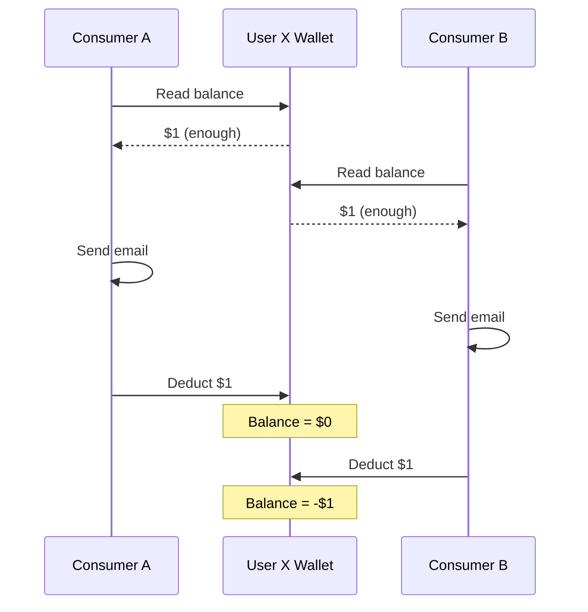
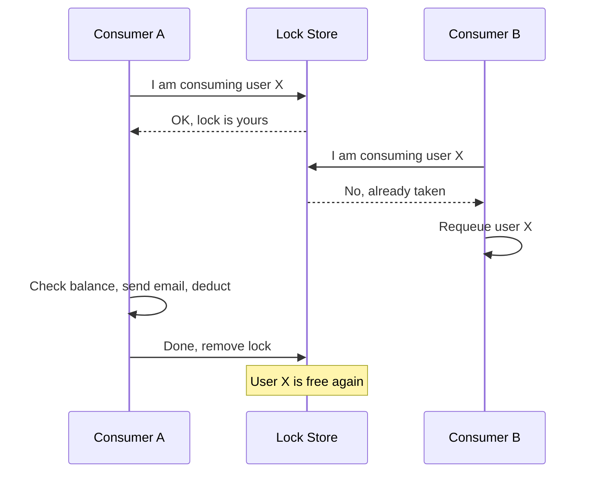
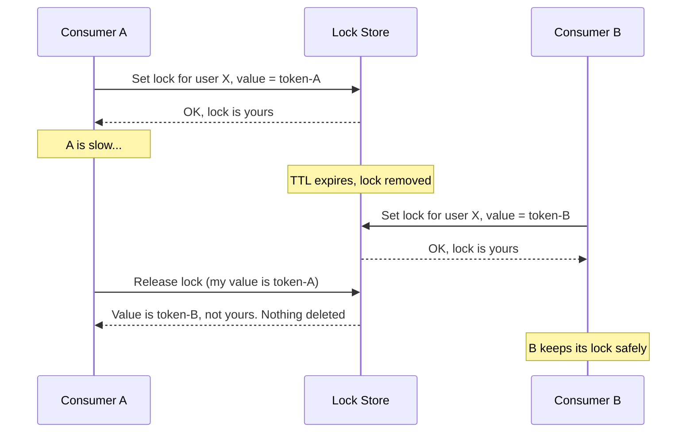
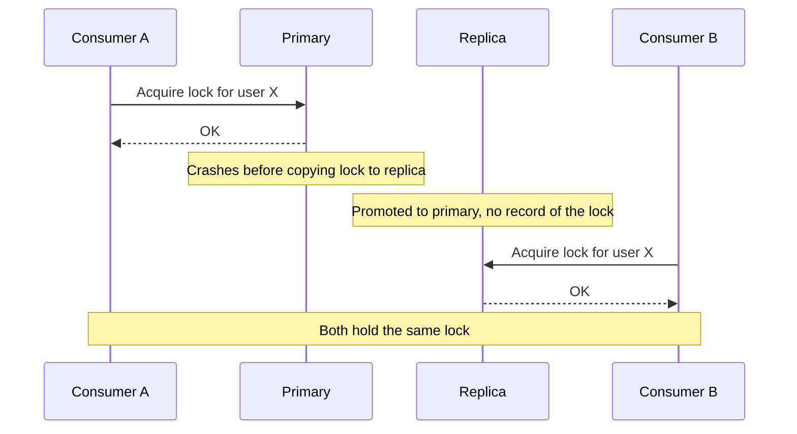
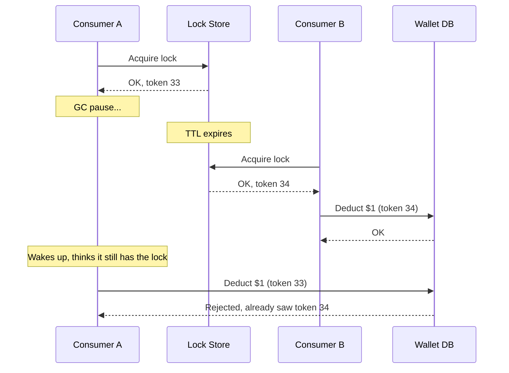

What are distributed locks? Why do we use them? And do we really need them?

Before diving deep into the world of distributed locks, we need to understand the fundamentals.

First, we need to understand the problem so we can find a solution. BTW, I am not giving any code in this article, so it doesn't matter which language you use. My main goal is to give you a mental model, so you can use distributed locks when you actually need them, not just because everyone says so.

## Problem
Let's assume you are an SWE at an email service provider. There are 1M users sending 10M emails, and for every email sent, you need to deduct from the user's balance. Before sending, you need to check the balance: does this user have enough to send the email? For this, you are using 100 queues that work non-stop. Now, the problem comes when multiple queue consumers start processing the same user at the same time. Let's say user X has $1 in their wallet, and you charge $1 per email. Both consumers start at the same time, and both read the balance, which is $1. That's enough to send an email, so both consumers send one. But when it's time to deduct, there is only $1 in the wallet for two deductions, which makes the user's wallet go negative. This is a common problem in distributed systems known as a race condition.

## Solution
Now that we understand the problem, we can find a solution. Before reading further, try to think: how can we solve it? Yes, correct!

1. Distributed Locks - we can make sure only one consumer works on a given user at a time across the whole system. That way, we solve the race condition.

Is there any other solution?

2. User-Based Queue - yes, we can also have a queue per user, but it's not ideal in this case. Why? Because we have 1M users, which is way too many queues, and on top of that, the average number of emails sent per user is low. So this solution will not work here. But where will it work? It works when you have a small number of users who each send a lot of emails, like 1,000 users sending 100M emails. There, a user-based queue makes sense.

## Implementation
Before I explain the implementation, you need to understand that this is just one problem and one scenario in the world of distributed systems. This problem shows up in different forms and ways, and you need to be able to recognize it and apply the proper fix.

Now think: how can we make sure that only one consumer processes a given user at a time? The answer is to have something shared across all consumers, where each consumer checks it and adds an entry saying, "I am consuming this user." After finishing, the consumer removes that entry so other consumers don't keep skipping that user. This is called acquiring and releasing a lock.

## Provider
Now we have a mental model of locking. Where you store your locks depends on your situation, for example:
1. **Small scale:** You have an application that needs locking, but you don't have a lot of users. I would recommend Postgres advisory locks, which are really good up to a certain scale. A nice bonus: the lock is tied to the database connection, so if a consumer crashes, Postgres releases the lock for you. Just be careful if you use a connection pooler like PgBouncer in transaction mode, because session-level advisory locks don't work well with it.
2. **Medium scale:** If you hit that mark and start seeing bottlenecks, move to Redis or Valkey. You can self-host it, or use a managed service that handles everything for you, so you can focus on your business. This is where all the challenges below (atomicity, TTL, ownership) really start to matter.
3. **Large scale:** If a single node is not enough for your application, run a Redis or Valkey cluster, where locks are spread across multiple nodes by key. And if correctness matters more than speed, look at consensus-based stores like etcd or ZooKeeper, which I cover in the Open Discussion section. This is a truly large scale of operation, and most of us, including me, will hardly ever reach this level.

## Challenges and My Learnings
1. Keep the key predictable - in the example, a consumer saying "I am consuming this user" means the consumer checks the store to see whether the user is already there. If yes, it requeues the job; if not, it adds the user to the store, does the operation, and removes it. For reading, adding, and removing, we need a key that all consumers agree on, so it's easy and safe. For example, the key can be `user_email_send_lock_{userId}`. This way, if we have another lock for the same user, the two will not conflict and cause problems.
2. Atomicity - let's say 2 consumers want to add the same key. Both read it as not acquired, both add it, and both do the operation, which is the same problem again. So we need the check-and-add to be atomic and unique. Now, whenever 2 consumers see the lock as not acquired and try to add the key, one will succeed and the other will fail, and that fixes the problem.
3. Use TTL - if we are already adding and removing the key from the store, why do we need a TTL? Let's say a consumer is working on user X, sending an email, but its operation never finishes and it never releases the lock. You need something that tells the store to remove the key, so other consumers don't get stuck when one fails to release it. Also, remember to set the TTL to 1.5x or more of the operation's max time, so the lock does not get released in the middle of processing.
4. Ownership - only the consumer that set a lock should be able to remove it. If any other consumer can remove it, the problem we are trying to solve comes back. But why would this even happen? Remember TTL from point 3: if consumer A is slow and its lock expires, consumer B gets the lock. When A finally finishes, it deletes B's lock, and now consumer C can come in while B is still working. So how do we stop that? Don't put the consumerId in the key, because then consumer A's key becomes `user_email_send_lock_A_42` and consumer B's key becomes `user_email_send_lock_B_42`. These are two different keys, so both consumers get a lock, and we are back to the race condition. Instead, keep the key the same, `user_email_send_lock_{userId}`, and store the owner as the value. When a consumer acquires the lock, it sets the value to its own unique ID. A random token generated for each lock is even safer than a fixed consumerId, because after a restart, a consumer could mistake an old lock for its own. When it wants to release the lock, it first checks: is the value still my token? If yes, it deletes the key. If not, someone else owns the lock now, so it leaves it alone. And remember atomicity from point 2: this check and delete must happen as one atomic operation (in Redis, people usually do this with a small Lua script). Otherwise, the lock can change hands between the check and the delete.

## Open Discussion
In this section, we will look at some decisions and try to understand what to do in certain scenarios.

1. What happens when the lock is already taken?

   In the example, we were requeuing the job, but is requeuing really the only option? Nope, there are a lot of things we can do:

   - We can requeue it, as in the example, and keep processing other jobs.
   - We can retry with backoff, which means trying again after some time. This works well when you don't have a lot of volume or the operation is short, so you don't lose much time.
   - Or we can just wait for the current operation to finish.

2. What happens when the lock store has multiple nodes?

   But first, why do we even need multiple nodes? Well, what happens if the store goes down? That would be a problem, right? The solution is a multi-node lock store, which keeps a replica of the same store. But here's the problem:

   1. Consumer A acquires the lock for user X on the primary node.
   2. The primary crashes before copying the lock to its replica.
   3. The replica is promoted to primary, but it has no record of the lock.
   4. Consumer B asks for the same lock and gets it.

Now two consumers hold the same lock, and we're back to our original race condition.

There are solutions for this, but as scale grows, most choices become debatable and come with trade-offs:
1. **Redlock:** Acquire the lock from a majority of independent lock store nodes (e.g., 3 out of 5).
2. **Consensus-based stores:** Also known as coordination services (e.g., ZooKeeper). They use consensus algorithms to ensure data consistency and fault tolerance across multiple nodes.

**Fencing tokens:** Even with a perfect lock store, a consumer can pause (because of a GC pause or network delay), lose its lock to TTL expiry, then wake up and continue as if it still holds the lock. A fencing token is an increasing number issued with each lock, and the wallet database rejects any write carrying a token older than one it has already seen.

Whew, we covered a lot! Hopefully, most of you got more than just a mental model. When you use distributed locks in your application, ask whether your lock is for **efficiency** or **correctness**. If a rare double execution just means some wasted work, a single Redis node is fine. If it costs real money, like in our wallet example, don't rely on the lock alone. Keep a database-level guard as your final safety net.